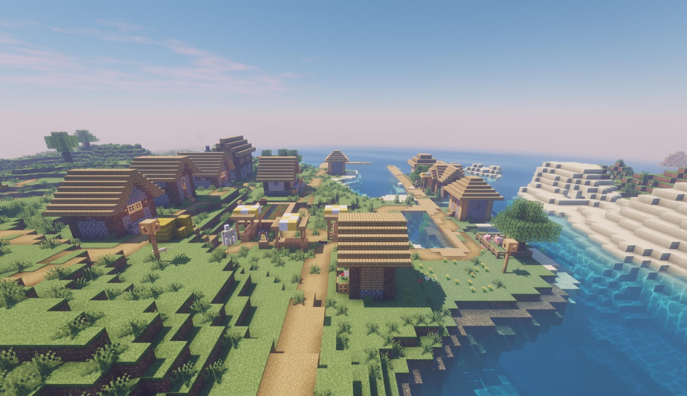
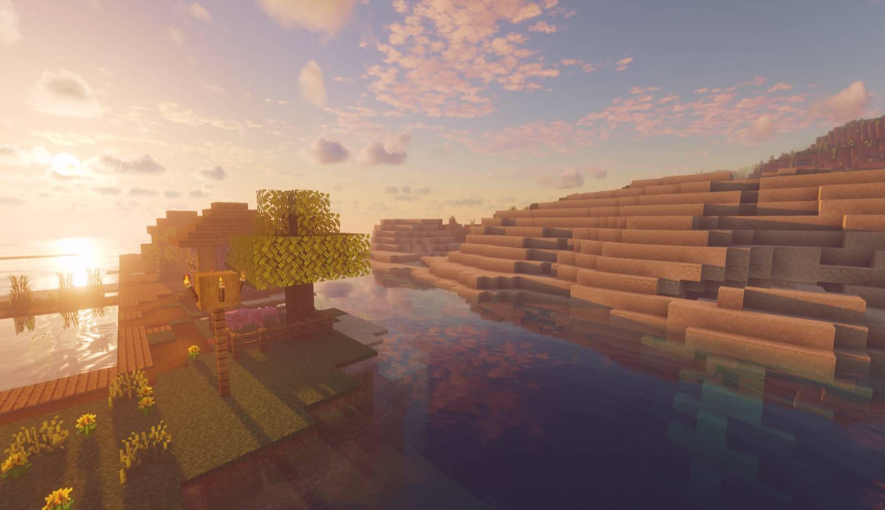
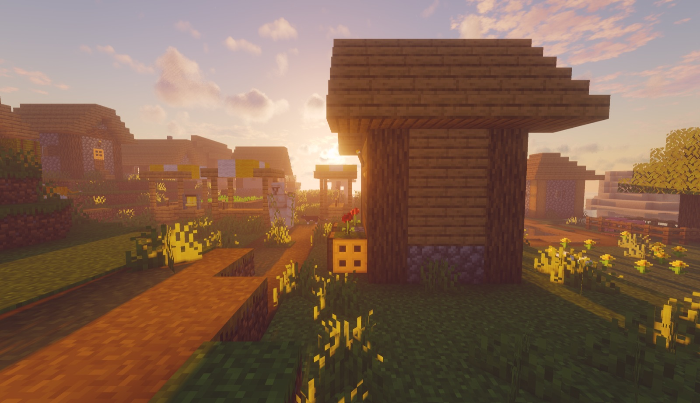
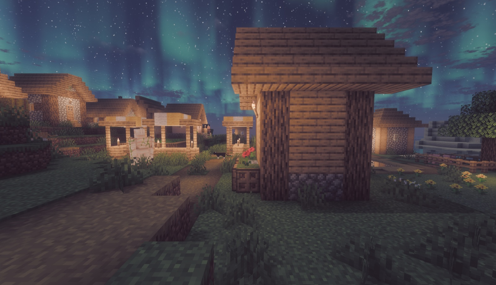
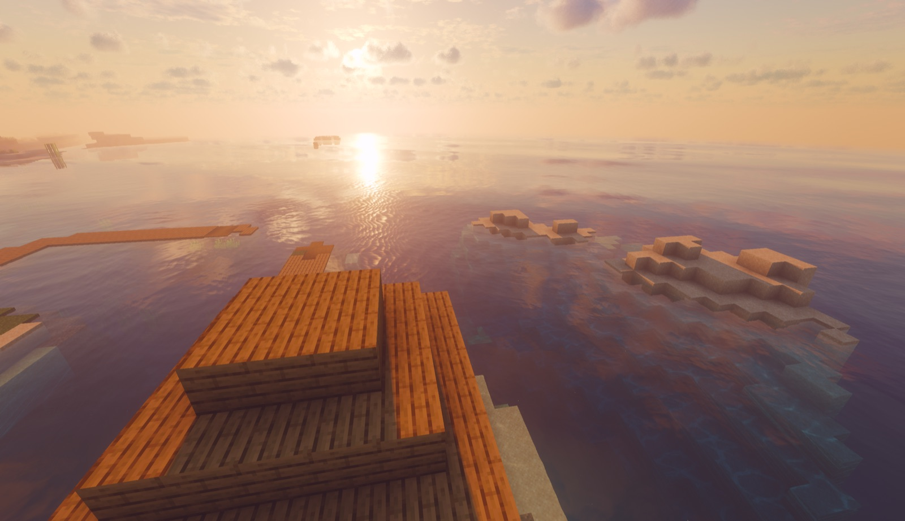
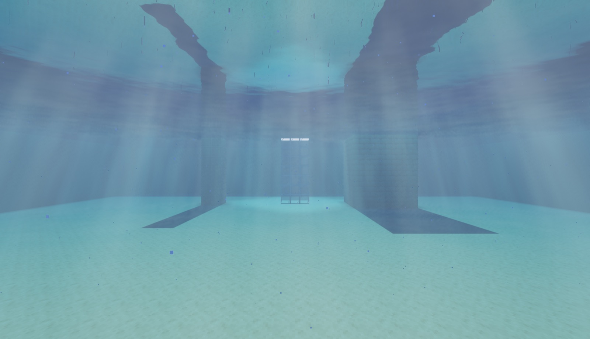
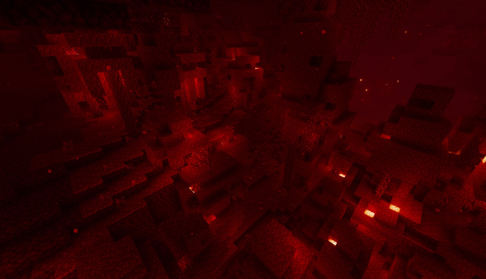
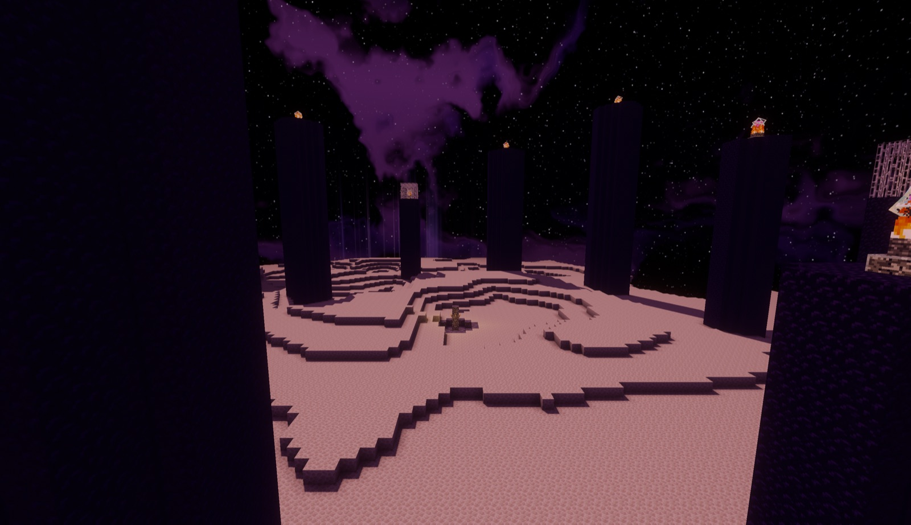

# Celestia Metal

**An independent, single-JAR, Apple Silicon-first Metal 4 / Metal 3 rendering engine and native MSL shader ecosystem for Minecraft: Java Edition 26.3 (Fabric).**

Celestia Metal replaces Minecraft's legacy OpenGL path with Apple's native **Metal 4** (`MTL4CommandQueue`, `MTL4ArgumentTable`, `MTL4Compiler`, `MTLResidencySet`) on macOS 26+ and **Metal 3** on macOS 15+, paired with an extensible **native Metal Shading Language (MSL) shader pack system**, **MetalFX Temporal and Spatial upscaling and TAAU**, **HDR / EDR (Display P3)** support, **120 Hz ProMotion** awareness, and a **CelestiaGlow**-inspired frosted observatory UI.

---

## Showcase

Celestia Native on an M1 Pro at native 3024 × 1744, Quality preset, Balanced look. The captures come from the in-game QA
harness (`tools/qa/run.sh shots`) in a natural plains village on the coast.

| | |
| --- | --- |
|  |  |
|  |  |
|  |  |
|  |  |

---

## Key Features

- **Single-JAR Installation**: Drop one JAR into `mods/` — no external toolchains, no manual JVM arguments, no Fabric API dependency required, and compatible with Sodium.
- **Metal 4 & Metal 3 Backend (`com.mojang.renderpearl`)**:
  - Java 25 Foreign Function & Memory (`java.lang.foreign`) bridge to `libcelestiametal.dylib`.
  - Unified-memory (`MTLStorageModeShared`) transient ring allocators and size-bucketed buffer pooling.
  - Native multi-draw batching, indirect draws, persistent `MTLBinaryArchive` pipeline caching, and deferred resource retirement tied to `MTLSharedEvent` completion.
  - Automatic SPIR-V → MSL 3.1 translation via LWJGL SPIRV-Cross for vanilla & modded RenderPearl pipelines, with selective relaxed IEEE math for terrain shaders.
- **Apple Silicon Hardware Features**:
  - **MetalFX Temporal, MetalFX Spatial and Celestia TAAU upscaling** with optional **Auto Render Scale** (65%–100%). Temporal suits large external displays. On a Retina laptop screen, native resolution or TAAU is faster, because MetalFX Temporal costs ~5.5 ms at 3024 × 1744 on an M1 Pro.
  - **HDR / EDR Highlights**: `RGBA16Float` Extended Linear Display P3 swapchain with configurable peak luminance.
  - **ProMotion & Thermal / Battery Awareness**: Detects 120 Hz ProMotion displays, macOS thermal state, and Low Power Mode.
  - **Startup Crash Guard**: Protects against crash loops without falsely locking the game into OpenGL if a crash wasn't caused by Metal.
- **Extensible Native MSL Shader Pack Ecosystem (API v1)**:
  - **Celestia Native** includes:
    - an atmospheric sky with stars, the Milky Way and aurora;
    - two-cascade sun and moon shadows and SSAO;
    - water with refraction, screen-space reflections, caustics, foam, swell, underwater light shafts and an optional physically correct Snell's window;
    - volumetric clouds, including cumulus congestus, and volumetric light;
    - surface weather;
    - dynamic and coloured block light;
    - Nether and End looks;
    - camera motion blur, bloom, and filmic tone mapping.
  - Five color looks: **Balanced** (default), Pastel, Epic, Storybook and Natural.
  - Celestia Native reads **labPBR 1.3** materials from active resource packs for vanilla and Sodium terrain. The **Materials** tab controls this feature.
  - Apply **Performance**, **Balanced**, **Quality**, or **Ultra** from Shader Packs, or tune individual effects in Shader Options. Changes take effect in the current world.
  - Install other native MSL packs as folders or `.zip` files in `shaderpacks/`, and switch packs in game without restarting. A **world pack** (`"kind": "world"`) replaces the world renderer's shaders file by file over Celestia Native's; see [SHADER_PACK_SPEC.md](SHADER_PACK_SPEC.md) §5 and the starter pack in [examples/shaderpacks/celestia-example-world](examples/shaderpacks/celestia-example-world).
  - Iris / OptiFine GLSL packs are hidden until the GLSL bridge is mature (`-Dcelestiametal.irisPacks=true` shows them for development).
  - Hotkeys in-game: **`O`** (Shader Packs), **`K`** (Pause/Resume Shaders), **`R`** (Hot-Reload Shaders).
- **CelestiaGlow Frosted Observatory UI**:
  - Replaces Vanilla Video Settings with a Reese's Sodium Options–inspired tabbed, searchable screen (`General`, `Quality`, `Performance`, `Apple Silicon`, `Shaders`, `Advanced`), integrates cleanly into Sodium 0.9+ / Reese's Sodium Options via Sodium's Config API when Sodium is installed, and includes dedicated Shader Packs and Shader Options screens plus a live Performance HUD pill.

---

## Requirements

- **Mac**: Apple Silicon (`M1` / `M2` / `M3` / `M4` or newer, `Apple7+` GPU family)
- **macOS**: macOS 15+ (Metal 3) or macOS 26+ (Metal 4)
- **Minecraft**: Java Edition **26.3**
- **Loader**: Fabric Loader **0.19.5+**
- **Java**: ARM64 **Java 25** (not x86_64/Rosetta)

---

## Installation

1. Install **Fabric Loader 0.19.5+** for **Minecraft 26.3**.
2. Download `celestia-metal-0.1.0-alpha.17.jar` from Releases (or build with `./gradlew build`).
3. Place the JAR in your instance's `mods/` folder.
4. Launch Minecraft. Celestia Metal activates automatically when **Graphics API** is set to **Default** (press **F3** to check the `Celestia Metal` debug entry).

---

## In-Game Benchmarks (Apple M1 Pro, native 3024 × 1744)

Measured with the in-game QA harness: 300 frames per scene under a slow camera pan, game window in front, Metal 4, 12 chunks,
2026-11-28. The village scenes are a natural plains village on the coast of the QA seed.

| Scene | Quality | Performance |
| --- | --- | --- |
| Village, noon | 73.3 FPS | 96.9 FPS |
| Village, sunset | 63.5 FPS | 84.0 FPS |
| Village, night | 65.6 FPS | — |
| Over the bay | 53.3 FPS | 76.7 FPS |
| Waterfront, noon | 48.5 FPS | 77.2 FPS |
| Waterfront, sunset | 42.1 FPS | 67.4 FPS |
| Beach (mostly water) | 35.5 FPS | — |
| Village, rain | 51.5 FPS | 69.5 FPS |
| Nether | 137.8 FPS | — |
| The End | 168.6 FPS | — |

Land views clear 60 FPS at native resolution on Quality. Water is the main cost, and Performance clears 60 FPS everywhere
measured. Reproduce with:

```sh
JAVA_HOME=/opt/homebrew/opt/openjdk@25 tools/qa/run.sh shots \
  -PqaJvm=celestiaqa.preset=Quality,celestiaqa.renderScale=100,celestiaqa.measureFrames=300,celestiaqa.timedPanYaw=0.14
```

See [docs/QA.md](docs/QA.md). `./gradlew runNativeTests` also runs synthetic 3024 × 1752 GPU benchmarks of the legacy
shader fixtures in `tools/fixtures/shaderpacks/`.

---

## Building & Testing from Source

Requires ARM64 **JDK 25** and Xcode / Command Line Tools (`clang` with macOS SDK):

```sh
# Build native dylib + single mod JAR + run JUnit 5 tests + privacy check
JAVA_HOME=/opt/homebrew/opt/openjdk@25 ./gradlew build check

# Run live Apple Silicon Metal 4 / Metal 3 GPU verification & 3024x1752 benchmarks
JAVA_HOME=/opt/homebrew/opt/openjdk@25 ./gradlew runNativeTests
```

The output single JAR is written to `build/libs/celestia-metal-<version>.jar` (`mod_version` in `gradle.properties`).

---

## Documentation

- [ARCHITECTURE.md](ARCHITECTURE.md) — Native Metal 4/3 backend, RenderPearl integration, memory & lifetime model, and Phase 2 roadmap.
- [DEVELOPMENT.md](DEVELOPMENT.md) — Engineering retrospective, design rationale, and debugging postmortems across `0.1.0-alpha.1`–`0.1.0-alpha.8`.
- [AGENTS.md](AGENTS.md) — Practical guide for AI agents and contributors (commands, invariants, FFM & Metal 4 pitfalls).
- [SHADER_PACK_SPEC.md](SHADER_PACK_SPEC.md) — Celestia Shader Pack API v1 guide for writing and porting native MSL shader packs (including Celestia Shaders).
- [docs/QA.md](docs/QA.md): the in-game QA harness (scenes, modes, profiling, image measurements).
- [docs/SHADER_PORT_PLAN.md](docs/SHADER_PORT_PLAN.md): the current state, roadmap and handoff notes, plus the shader-port history.
- [CREDITS.md](CREDITS.md) — Explicit attributions and licenses for the Apple Silicon Minecraft Metal ecosystem.
- [CHANGELOG.md](CHANGELOG.md) — Release history.

---

## License

Licensed under the **Apache License 2.0** — see [LICENSE](LICENSE) and [NOTICE](NOTICE).
